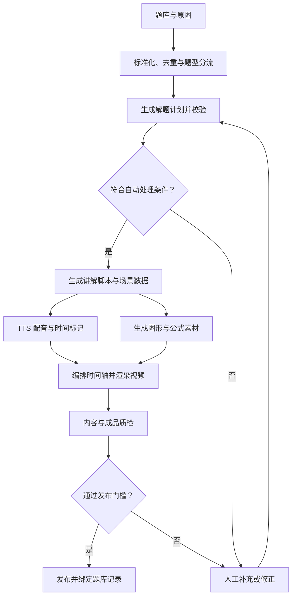

# 题库讲题视频生产线方案

本文归档 2026-10-08 形成的生产线方案，保留原方案的八个部分及主要建议，并将会话表达整理为仓库文档。

**状态：设计提案，尚未实施完整生产线。** 当前仓库已迁入的只有《古诗里的位置：有序数对与平移》单题示例和独立制作入口，实际使用方式见[模块 README](../README.md)。题库导入、通用解题生成、模板库、任务队列、审核后台、成本管理和题库回写等均为拟建设能力。

本文沿用约 600 万条 K12 题库记录作为规模规划背景；5–8 类模板、1,000 题验证、1 万至 10 万题运行均是原方案建议，未构成已确认的试点范围、预算或交付承诺。原方案提到的“鸡兔同笼”和“古诗数对与平移”两个样片用于说明方法验证，不能视为仓库已经具备两个通用模板或批量生产能力。

## 方案概述

**沿用 Pillow + NumPy 逐帧绘图、TTS 配音、FFmpeg 合成，能够搭建一条面向题库的讲题视频生产线。**

以约 **600 万道 K12 题目**作为规划背景，建议按“**分题型建设、批量生产、分级审核、逐步覆盖**”的方式实施。原方案基于两个样片对绘图、配音和视频合成链路的验证；要服务整个题库，还需要补齐题目标准化、解题校验、模板体系、任务调度和审核发布。

首期可以定一个具体目标：

> **选定 5–8 类标准数学题，打通“题库导入 → 自动讲解 → 配音动画 → 质检审核 → 视频回写题库”的闭环，先用 1,000 道真实题验证，再扩到 1 万、10 万道。**

下面按产品、技术、质量和成本展开。

## 一、如何把现在的方法变成生产线

### 1. 从逐题编写，转为按题型复用

“鸡兔同笼”样片，包含一套可以重复使用的教学结构：

1. 展示动物总数、腿的总数。
2. 假设全部是鸡。
3. 计算假设模型与实际腿数的差。
4. 演示“一只鸡换成一只兔，多出两条腿”。
5. 算兔子数量，再算鸡的数量。
6. 验证动物总数和腿数。

这套结构可以做成模板。题目的数字、计算结果、旁白和画面对象，则由输入参数生成。

设动物总数为 $N$，腿的总数为 $L$：

$$
\text{兔子数量}=\frac{L-2N}{4-2}
$$

$$
\text{鸡的数量}=N-\text{兔子数量}
$$

于是：

- 输入“8 只动物、22 条腿”，生成“3 只兔子、5 只鸡”的讲解。
- 输入“35 只动物、94 条腿”，生成“12 只兔子、23 只鸡”的讲解。

**这里需要复用的是解题逻辑、教学步骤和视觉规则。** 模板还要根据题目调整布局：8 只动物可以逐只画，35 只动物则适合分组表示，配合数量卡片和局部替换动画。

生产线也要先检查输入是否合法。例如，在动物只有鸡和兔的前提下，必须满足：

$$
2N\leq L\leq4N
$$

而且 $L-2N$ 必须是偶数。如果输入“8 只动物、23 条腿”，系统应当提示条件存在问题，进入检查流程。

### 2. 让 AI 生成讲解数据，让程序稳定渲染

建议把职责分清：

- **AI 负责理解题目、选择方法、组织教学语言。**
- **规则和计算程序负责验证可以检查的数学内容。**
- **经过验证的动画模板负责逐帧绘制。**
- **TTS 和视频合成程序负责输出成品。**

这样，每一题的变化主要体现在结构化数据中，渲染程序可以持续复用。

一开始可以设计三层数据：

| 数据层 | 保存的内容 | 作用 |
|---|---|---|
| 题目数据 | 题干、选项、图片、条件、未知量、单位、答案、年级、知识点、来源 | 确认系统理解的是哪道题 |
| 解题数据 | 每一步使用的条件、计算过程、理由、结果、适用范围、验算 | 检查答案和推理是否成立 |
| 场景数据 | 使用的模板、图形对象、公式、旁白、字幕、动画事件、时间标记 | 把解题过程转换为视频 |

数字、公式、旁白和图形数量，都从同一份已验证的数据生成。例如“兔子是 3 只”这个结果，应同时驱动画面中的兔子数量、字幕中的数字和 TTS 的读法。

这能减少“答案写着 3，画面画了 4，旁白又说成 5”这类跨环节错误。

## 二、推荐的整体生产流程

这里有三个特别影响规模化的设计。

### 先做题目标准化

题库中的题目可能是 HTML、LaTeX、图片、Word 导入内容，或者这些形式的混合。

生产前需要统一：

- 分数、根号、指数、上下标和特殊符号。
- 图片和题干的引用关系。
- 选择题选项、填空位置和多小问结构。
- 单位、变量名称、条件和答案格式。
- 原题、参考答案、已有解析之间的对应关系。

已有答案和解析很有价值，但仍要保留来源和版本。出现“题干与答案不一致”“解析引用了题目没有给出的条件”等情况时，应当分流处理。

### 以真实配音安排动画

生成旁白后，先取得实际音频时长，再安排字幕和动画事件。

例如，读到“每换成一只兔子，就增加两条腿”时，画面应当恰好进行一次替换，并亮起增加的两条腿。可以通过分句音频、服务商提供的时间标记，以及模板中的语义事件完成对齐。

正式的语音服务已经有适合批处理的接口。例如 Azure Speech 的批量合成支持异步提交大批量文本、查询任务状态并获取音频结果。具体接入时，可以把这些能力封装成统一的 TTS 服务接口。 [Azure Speech 批量合成文档](https://learn.microsoft.com/en-ca/azure/ai-services/speech-service/batch-synthesis)

### 每个阶段都能独立重试和追踪

题量大以后，网络超时、音频调用失败、渲染进程中断都会出现。任务需要记录：

- 当前做到哪一步。
- 使用了哪个题目、解析、模板和音色版本。
- 哪一步失败、已重试几次。
- 已经产生哪些可复用的中间结果。
- 是否需要人工处理。

例如，上传成品失败时，可以直接重传已有视频；修改了一句旁白后，则重新合成相关语音，并重新编排受影响的时间轴和视频。

## 三、哪些题适合先做，怎样逐步覆盖整个题库

建议先按题型的可验证程度和画面表达难度，分批建设。

| 范围 | 建议处理方式 | 主要工作 |
|---|---|---|
| 四则运算、分数和百分数、简单方程 | 优先自动化 | 计算步骤、公式排版、读法和验算 |
| 鸡兔同笼等标准数量关系应用题 | 优先建设模板 | 条件提取、方法选择、数量关系动画 |
| 数对、坐标、平移、简单统计图 | 优先建设图形模板 | 坐标和图形数据一致、对象运动准确 |
| 函数图像、较复杂几何变换、部分概率题 | 第二阶段扩展 | 专门的图形组件、边界条件和步骤校验 |
| 复杂几何证明、多条件综合题 | 人工协同生产 | 教研确认推理，再自动制作画面和配音 |
| 开放题、主观题、条件残缺题 | 单独设计流程 | 评价标准、可接受答案范围、缺失内容处理 |

如果题库横跨语文、英语、物理、化学等学科，还需要分别建设教学规范。例如：

- 阅读理解需要说明答案所依据的原文和语境。
- 物理题需要区分条件、模型、公式适用范围和单位。
- 化学实验题需要准确表达操作、现象和结论。
- 主观题可能需要展示答案结构、评价标准和多种合理表达。

这些都可以采用程序绘图和 TTS，但解题数据、画面组件和审核标准会有所不同。

### 600 万条题库记录，需要先转换成实际生产数量

最终的视频数量，应按“独立讲解单元”统计。

| 题库情况 | 建议处理方式 |
|---|---|
| 完全相同的重复题 | 经核对题干、图、选项、答案与讲解一致后，复用一个视频 |
| 同题型、数字不同 | 复用模板，重新生成对应计算、旁白和画面 |
| 同一道题有两种教学方法 | 按需要生成不同讲解版本 |
| 一道大题包含多个独立小问 | 根据教学需要合并讲解或拆分视频 |
| 缺图、缺条件、答案冲突 | 先修复数据，再进入生产 |

因此，去重可以减少重复生产；多小问、多方法和多语言版本也可能增加实际视频数量。

在产品策略上，可以先生成高频使用题、重点知识点和常用试卷中的题目。长尾题可以在被请求后进入生产队列，通过检查后提供视频。这样更容易把投入与实际使用量对应起来。

## 四、质量控制是能否规模化的关键

视频能正常播放，只能说明媒体文件合格。讲题视频还要确保题目、推理、图形和语音一致。

建议设置五道检查。

### 1. 题目理解检查

重点检查会改变题意的内容：

- 负号、指数、分数线有没有识别错。
- 单位有没有丢失。
- “至少”“恰好”“不超过”等条件有没有保留。
- 图中的标注是否完整。
- 小问有没有遗漏。

题目理解不完整时，应在生成配音和视频前拦截，避免继续产生费用。

### 2. 数学检查

对可计算题型，可以组合使用：

- 重新计算答案。
- 将答案代回原条件。
- 检查取值范围、整数性和单位。
- 检查表达式是否等价。
- 检查每一步变形的适用条件。

方程和代数内容可以引入 SymPy 等符号计算工具辅助求解与校验；题意、单位和教学推理仍需由系统规则和审核流程共同检查。 [SymPy 求解器文档](https://docs.sympy.org/latest/modules/solvers/solvers.html)

对于鸡兔同笼模板，可以把校验写得非常具体：

- 每次替换后，鸡和兔的总数仍为 8。
- 每换一只，鸡减少 1，兔增加 1。
- 假设模型中的腿数增加 2。
- 模型依次展示 $16\rightarrow18\rightarrow20\rightarrow22$ 条腿。
- 最终结果同时满足 8 只动物和 22 条腿。

这里要区分“原题事实”和“假设模型状态”：中间动画展示的是逐步调整的模型，最终才同时符合原题的两个条件。

### 3. 教学检查

答案正确，也可能讲得不适合学生。

需要检查：

- 方法是否符合目标年级。
- 关键理由是否讲清楚。
- 是否跳过了学生需要理解的步骤。
- 是否引入未给出的条件。
- 是否把“图上看起来如此”当成数学依据。
- 是否花了大量时间重复读题，却没有解释解题关系。

模型之间的交叉检查可以辅助发现问题，发布门槛仍应结合可验证的规则、计算结果和教研审核。

### 4. 画面与语音检查

例如：

- $\frac{3}{4}$ 要读成“四分之三”。
- 平方、平方厘米、负数、字母和分数的读法要明确。
- 画面上的数字与旁白一致。
- 讲到某个对象时，高亮对应对象。
- 公式、题干、字幕没有遮挡或超出画面。
- 动画中鸡、兔、点、线、格子的数量和位置符合数据。

复杂公式可以先通过 MathJax 生成 SVG，再转换成适合 Pillow 合成的图像素材。MathJax 官方提供 SVG 数学输出方式，适合把公式排版独立为一个可复用组件。 [MathJax SVG 输出文档](https://docs.mathjax.org/en/latest/output/svg.html)

### 5. 成品与发布检查

自动检查应覆盖实际编码后的成品，包括：

- 文件能够完整解码。
- 有视频、有声音，时长合理。
- 音频没有明显截断或长时间意外静音。
- 场景切换前后、关键动画事件前后的画面正常。
- 字幕和画面处于正确的时间段。

**首批模板和验证集建议逐条审核。** 模板稳定后，再根据题型、历史问题和内容风险设计抽检比例。发现模板级错误时，需要能定位受影响的视频、暂停相关任务并修复版本。

## 五、建议的技术实现方式

可以采用 Java/Spring 与 Python 配合的职责划分；具体接入方式再根据题库现有系统决定。

| 模块 | 建议职责 |
|---|---|
| 现有业务后端或 Java/Spring 服务 | 题库接口、任务创建、状态管理、权限、成本记录、发布回写 |
| Python 内容与渲染工作进程 | 数据校验、数学计算、场景编排、Pillow/NumPy 绘图、FFmpeg 合成 |
| TTS 适配层 | 音色、语速、读法规则、分句合成、缓存、限流、错误重试 |
| Vue 审核后台 | 同时查看原题、解题步骤、视频和字幕，修改、退回、批准 |
| 数据库与消息队列 | 保存题目和视频关联，可靠分发任务，支持暂停、恢复和重试 |
| 对象存储与 CDN | 保存成品和必要素材，支持视频播放与分发 |

首期可以做一个任务管理服务，外接可扩容的 Python 工作进程。随着实际吞吐增长，再拆分最需要独立扩容的环节。

### 渲染层可以继续以 Pillow + NumPy 为核心

推荐保留的能力包括：

- Pillow：文字、版面、卡片、图形和素材合成。
- NumPy：位置计算、动画插值、坐标转换和像素处理。
- FFmpeg：视频编码、音视频合成和成品检查。
- 独立公式组件：统一处理数学排版。
- 独立几何、函数组件：处理更复杂的数学图形。

模型调用集中在理解题目和生成讲解结构的阶段；逐帧绘制交给确定性的程序执行。

### 从一开始做好复用和版本管理

这几项会直接影响长期成本：

- 共用字库、通用图形、背景和动画组件。
- 对已验证的解题结果、旁白和音频做缓存。
- 为题目、模板、讲解和音色参数分别记录版本。
- 重复提交同一任务时，识别已有结果，避免重复调用。
- 修改内容后，只重跑受影响的阶段。
- 保存足够的结构化数据和清单，使视频能够重现。

正式生产时，可以保留 MP4、音频、字幕、场景数据和关键预览图。逐帧绘制过程中的原始图片适合作为临时数据处理，通用字库和素材集中复用。

## 六、成本与产能：先建立可测量的模型

成本至少要分成三部分：

1. **建设成本**：系统开发、模板制作、教研规范和审核后台。
2. **生产成本**：题目处理、模型调用、TTS、渲染、重试和审核。
3. **服务成本**：长期存储、视频播放流量和运维。

### 用估算模型比较生产规模

保留原方案形成时的规划单价示例（不作为持续有效报价）：阿里云智能语音交互的 **CosyVoice 大模型语音合成为 2 元/万计费字符**，其规则中 **1 个汉字按 2 个字符计算**，标点等也参与计费。这个单价仅作为规划示例，实际应按最终选择的产品和账单口径核算。 [阿里云智能语音交互计费说明](https://help.aliyun.com/zh/isi/product-overview/billing-10)

原方案使用可调估算器，按视频数量与渲染并发比较假设条件下的渲染时间、成片容量和 TTS 费用。**这些是规划计算，并非样片测得的整条生产线性能，也不是项目总报价。**

归档说明：原会话中的交互式估算器未随本文归档；这里保留其用途、成本口径和全部限制说明，不据此宣称已获得实测产能。正式决策前应补齐单条时长、码率、计费字符数、渲染耗时、有效并发和重跑比例等输入，并按实测结果核算。

使用这个模型时，需要注意：

- **渲染时间只覆盖渲染阶段。** 题目处理、TTS 排队、人工审核、上传和返工都会影响整体交付时间。
- **一个并发任务槽要通过实测定义。** 应记录该任务所需的 CPU、内存和编码配置，再测量多个任务同时运行时的速度。
- **重跑比例只用于计算额外工作量。** 自动审核通过率需要单独实测。
- **存储量只计算单个最终视频版本。** 音频、源素材、多清晰度、备份和历史版本需要另算。
- **TTS 费用只是成本的一部分。** 模型调用和人工审核可能显著改变总成本。

TTS 服务还有独立的并发配额，增加渲染工作进程后，要同时确认语音接口能够提供相应吞吐。服务商对不同接口可能设置不同额度，需要按实际使用的服务核对和申请。 [阿里云并发与监控说明](https://help.aliyun.com/zh/isi/getting-started/faq-about-concurrency-and-monitoring)

### 人工审核量要单独算

假设每条视频只花 **3 分钟**观看和检查：

$$
600万\times3分钟=30万小时
$$

即便只抽看 2%，也需要约 **6,000 小时**。这里的 2% 仅用于展示工作量，实际审核比例应根据题型验证结果决定。

因此，减少审核成本的有效途径，是把已验证的教学结构、计算规则和视觉规则固化为模板，并让审核人员集中检查变化部分和高风险内容。

建议系统从第一批任务开始记录：

$$
\text{平均单条生产成本}
=
\frac{\text{处理、模型、配音、渲染、重试及审核费用}}
{\text{实际通过审核并发布的视频数}}
$$

播放流量、长期存储和运维按月另行统计。这样才能看清“生产一条合格视频花多少钱”和“这条视频被使用后花多少钱”。

## 七、建议分四个阶段落地

| 阶段 | 主要工作 | 进入下一阶段前要拿到的结果 |
|---|---|---|
| 1. 数据审计 | 抽查题库格式、字段完整度、图片、答案解析、重复情况和题型分布 | 明确首批支持范围，估计可处理数量，列出数据修复任务 |
| 2. 1,000 题验证 | 建设 5–8 类模板，生成视频，并逐条审核 | 验证讲解正确性、无需改稿通过率、人工修改量和单条成本 |
| 3. 1 万至 10 万题运行 | 验证队列、限流、重试、审核、发布和回滚 | 得到稳定吞吐、资源配置、错误分布和运营成本 |
| 4. 持续扩展覆盖 | 增加题型与学科，结合使用频率安排生产 | 形成可持续更新的模板体系和视频资产 |

### 1,000 题验证集要有代表性

建议先确定首期学段和题型，再按题型、难度、图文形式、来源分层抽样，避免只挑最容易处理的题。

可以把其中一部分用于调试，其余留作独立验收；相同原题和近重复题应放在同一组，减少重复题对结果的影响。另外单独准备缺图、条件矛盾、符号易识别错等挑战题，检查系统能否正确拦截。

首批至少看以下指标：

| 指标 | 回答的问题 |
|---|---|
| 支持范围覆盖率 | 目标题库中有多少题属于当前能处理的范围？ |
| 解题与讲解正确性 | 已生成的讲解是否有答案或关键推理错误？ |
| 无需人工改稿发布率 | 支持范围内，多少题能直接通过审核？ |
| 人工修改时间 | 每条题实际需要多少教研和审核投入？ |
| 单条成本与耗时 | 费用花在哪一步，哪个环节限制吞吐？ |
| 重试与恢复情况 | 故障后能否恢复，是否产生重复任务和重复费用？ |

验收集没有观察到关键错误，是一个必要的阶段性结果；它还需要后续运行数据持续支持，才能决定扩大自动发布范围。

## 八、建议的首期项目定义

**项目：数学讲题视频自动生产与审核系统。**

首期范围可以优先包括：

- 鸡兔同笼等标准数量关系题。
- 数对、坐标与平移。
- 基础四则运算。
- 分数与百分数中的若干标准题型。
- 简单一元一次方程。

这些题型容易建立明确的计算与画面规则，也能复用两个样片中的部分经验和组件。

首期系统应交付六项能力：

1. **批量导入题目**，保留原题、答案、解析和图片。
2. **自动生成结构化讲解**，展示计算依据和验算结果。
3. **自动制作配音、字幕和动画视频**。
4. **提供审核后台**，定位问题、修改内容和重新生成。
5. **将视频地址与版本回写题库**，供学生端播放。
6. **按题目记录成本、耗时和审核结果**，支持后续扩产决策。

启动数据可以按“题目 ID、学科、年级、题干、选项、图片、参考答案、已有解析、知识点、来源”整理。缺失字段如实记录，先通过抽样确定数据质量。

**这条生产线在技术上可以实施，现有 Pillow + NumPy 方法可以继续作为渲染核心。首期最有价值的成果，是一套能够稳定生产、检查、审核和回写题库的闭环，以及 1,000 道真实题的正确性、成本和人工投入数据。有了这些，600 万道题的覆盖顺序、人员配置和扩产预算就能据实安排。**
